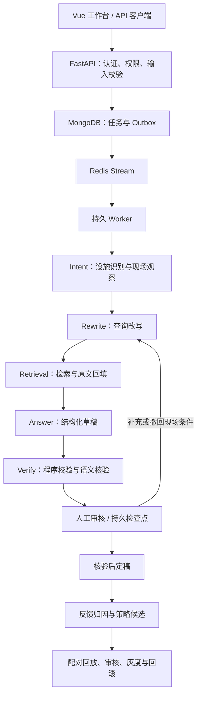

# XFAgent

[](https://github.com/auince/XFAgent/actions/workflows/ci.yml)

面向消防巡检的多模态辅助 Agent，围绕 **Agent Harness、可信 RAG、持久化人工审核、分层记忆和反馈驱动的策略迭代**构建。

用户提交巡检问题与设施照片，系统提取现场观察、检索适用条款、生成隐患说明和整改建议，再由复核员确认现场条件并审核报告。当前业务覆盖室内消火栓、室外消火栓和灭火器。

本项目用于工程实践与技术展示。默认模型接口为 **Qwen3.5-9B**；仓库不包含模型权重、法规正文、现场照片、评测数据、私有文档或部署凭据。下面的场景、账号及输出均为明确标记的仿真示例。

## 核心能力

| 模块 | 实现 |
| --- | --- |
| Agent Harness | LangGraph 固定五阶段主链，设施子图、有界纠错、调用与时间预算、任务取消、租约检查和执行追踪 |
| 可信 RAG | MongoDB 保存法规原文、生命周期、版本链和来源哈希；检索候选回填原文后，校验版本、日期、地域与适用条件 |
| 混合检索 | BM25、Milvus 向量召回、RRF 融合，支持独立 Reranker、多查询改写和可选 HyDE |
| 视觉与案例 | 接入检测器定位和多模态观察；历史案例作为辅助背景，不能替代本次现场事实或法规证据 |
| 人工审核 | 编辑结构化结论、补充或撤回现场条件；通过 MongoDB 检查点恢复流程，修订号防止重复或过期审批 |
| 分层记忆 | Redis 工作记忆，MongoDB 情景记录、用户偏好和组织经验，以及受控程序性策略；按权限、时效和上下文预算装配 |
| 反馈迭代 | 错误归因、受限 Skill / Hook / Rule 候选、配对回放、稳定分桶灰度、指标门禁与回滚 |
| 业务工作台 | 巡检、历史报告、人工审核、法规查询、多轮会话、记忆、反馈、策略及运行监控等独立页面 |

## 执行架构



五阶段主链固定执行；Verify 内部包含有界纠错，人工补充信息也可触发新一轮执行，因此整个状态图包含受控回路。默认预算为单任务最多 16 次模型调用、300 秒主动执行时间；检索轮数和答案修复次数也有限制。

RAG 的事实与索引分开管理：

```text
原问题 + 术语 + 会话上下文
          ↓ Query Rewriter
     BM25 + Milvus 候选召回
          ↓ RRF / 可选 Reranker
     MongoDB 回填原始条款
          ↓ 版本、哈希、生效日期、地域、条件校验
     结构化结论 + 原文引用 + 缺失现场信息
```

用户偏好、历史案例和组织经验均不作为官方法规引用。照片无法可靠提供的压力、尺寸和配置数量，保留为待确认信息。

## 版本演进

标签对应清理后的各版代码提交。发布时剔除了文档、数据和本机配置，保留迭代顺序与提交说明；初始基线已经包含原有平台能力，后续版本体现原型演进、重构及业务接入。

| Tag | 版本内容 |
| --- | --- |
| [`baseline-main`](https://github.com/auince/XFAgent/tree/baseline-main) | 原 main 代码基线 |
| [`v1.0.0`](https://github.com/auince/XFAgent/tree/v1.0.0) | 文档切块、向量检索、问题与图片输入，自建基础 Harness 原型 |
| [`v2.0.0`](https://github.com/auince/XFAgent/tree/v2.0.0) | 接入 MongoDB 原文事实库及混合检索链路 |
| [`v3.0.0`](https://github.com/auince/XFAgent/tree/v3.0.0) | 使用 LangGraph 固定 Intent → Rewrite → Retrieval → Answer → Verify |
| [`v4.0.0`](https://github.com/auince/XFAgent/tree/v4.0.0) | 人工审核及基于 XFDemo 适配的多页面工作台 |
| [`v5.0.0`](https://github.com/auince/XFAgent/tree/v5.0.0) | 多轮会话与分层记忆接入 |
| [`v6.0.0`](https://github.com/auince/XFAgent/tree/v6.0.0) | 检测证据适配、检测框展示及历史案例参考 |
| [`v7.0.0`](https://github.com/auince/XFAgent/tree/v7.0.0) | 结构化人工修订、现场条件确认与持久检查点恢复 |
| [`v8.0.0`](https://github.com/auince/XFAgent/tree/v8.0.0) | 分层 LangGraph Harness、执行治理与服务生命周期完善 |
| [`v9.0.0`](https://github.com/auince/XFAgent/tree/v9.0.0) | 反馈策略闭环接入工作台，补强事务一致性、归因修订与发布门禁 |

`main` 还包含发布整理和 README 更新；这些不回写到已有版本标签。历史标签用于查看各阶段实现，以下启动说明针对当前 `main`。

```bash
git clone https://github.com/auince/XFAgent.git
cd XFAgent
git tag --list
# 查看某个版本（分离 HEAD）
git switch --detach v5.0.0
# 回到当前版本
git switch main
```

## 快速体验：无需 GPU 的仿真工作台

需要 Python 3.12、Node.js 22.12+、支持事务的 MongoDB 副本集和 Redis。先自行准备 MongoDB 与 Redis；以下连接地址仅为本机示例，不含实际部署信息。

```bash
python3.12 -m venv .venv
source .venv/bin/activate
pip install -r requirements-v2.lock
npm ci --prefix apps/console
npm run build --prefix apps/console

export PYTHONPATH=src
export XF_V2_MONGO='mongodb://127.0.0.1:27017/?replicaSet=xfagent&directConnection=true'
python scripts/console_ui_fixture.py
```

打开 **http://127.0.0.1:8081/**。

| 仿真角色 | 账号 | 仿真密码 |
| --- | --- | --- |
| 巡检员 | `inspector` | `ui-fixture-only` |
| 复核员 | `reviewer` | `ui-fixture-only` |
| 管理员 | `admin` | `ui-fixture-only` |

这个入口只绑定本机，固定使用 `xfagent_console_fixture` 数据库和 `redis://127.0.0.1:6379/3`，在同一进程内启动测试 worker。请使用独立的开发数据库；勿将该入口作为对外部署方式。

仿真模式使用真实的任务持久化和审核流程，但模型、检测器、案例与检索响应均由代码夹具注入，不需要 Milvus、GPU 或真实法规库，也不用于测量模型准确率。策略发布在该模式下被禁止。

## 使用示例

### 1. 提交问题和照片，查询异步报告

在另一个终端激活同一 Python 环境后运行。`XF_EXAMPLE_IMAGE` 可指向你自己的 JPEG / PNG；未设置时演示文字巡检。

```python
import base64
import os
import time
from pathlib import Path

import requests

base = os.getenv("XF_EXAMPLE_API", "http://127.0.0.1:8081")
client = requests.Session()
response = client.post(base + "/api/login", json={
    "username": "inspector",
    "password": os.getenv("XF_EXAMPLE_PASSWORD", "ui-fixture-only"),
}, timeout=15)
response.raise_for_status()

payload = {
    "query": "消火栓箱前堆放了杂物，请说明需要核查的问题和整改建议。",
    "facility": "indoor_hydrant",
    "project_id": "default",
    "session_id": "example-inspection-001",
    "jurisdiction": "四川",
    "retrieval_mode": "rerank",
    "scene": {},
}
image_path = os.getenv("XF_EXAMPLE_IMAGE")
if image_path:
    path = Path(image_path)
    mime = "image/png" if path.suffix.lower() == ".png" else "image/jpeg"
    encoded = base64.b64encode(path.read_bytes()).decode("ascii")
    payload["image"] = f"data:{mime};base64,{encoded}"

response = client.post(base + "/api/inspect", json=payload, timeout=30)
response.raise_for_status()
run_id = response.json()["id"]

for _ in range(180):
    response = client.get(base + f"/api/reports/{run_id}", timeout=15)
    response.raise_for_status()
    report = response.json()
    if report["durable_status"] not in {"queued", "running"}:
        break
    time.sleep(2)
else:
    raise TimeoutError(f"任务尚未完成，请稍后查询：{run_id}")

print("任务：", run_id, "状态：", report["status"])
print("核查结论：", report.get("conclusions", []))
print("引用证据：", report.get("evidence", []))
```

HTTP `202` 表示任务已入队。可检查 `durable_status` 区分等待审核、缺少信息和执行失败；工作台将它转换为更易读的报告状态。需要重试提交时，可提供固定的 `Idempotency-Key`，并在同一次提交的重试中保持请求内容不变。

以下仅展示结构化结论的格式，内容为仿真示例，证据不足时不生成法规判定：

```json
{
  "claim_id": "c1",
  "kind": "information_request",
  "text": "请现场确认杂物是否影响消火栓取用。",
  "recommendation": "核实后清理影响取用的物品，并补拍现场照片。",
  "observation_ids": [],
  "evidence_ids": [],
  "applicability": "unknown",
  "sufficiency": "insufficient",
  "missing_fields": []
}
```

### 2. 人工确认现场条件并恢复流程

使用 `reviewer` 登录工作台，可以编辑结论、选择关联条款、确认现场条件，再批准、退回补充或驳回。程序会重新核验修改后的结论，审批操作不会绕过事实检查。

对应接口为 `POST /api/reports/{run_id}/review`。下面是**退回并补充条件**的请求示例：`expected_revision` 必须替换为刚读取的报告修订号；测量值仅示范数据格式，不代表规范限值。

```json
{
  "expected_revision": 1,
  "action": "return",
  "comment": "已补充现场测量，请结合适用条款重新生成核查草稿。",
  "confirmed_scene": {
    "measured_width": {"value": 1.2, "unit": "m", "confirmed": true}
  }
}
```

带有新条件的退回会从持久检查点恢复，并重新进入改写、检索和生成。撤回条件使用 `cleared_scene_fields`；同一字段不能同时确认和撤回。审核请求返回 `202` 后继续轮询报告；遇到 `409` 应重新读取修订号和核验结果。

### 3. 同一会话继续追问

沿用示例 1 的登录会话和 `session_id`，等待上一轮任务完成后提交：

```python
response = client.post(base + "/api/inspect", json={
    "query": "如果已经移走杂物，还需要补充哪些现场信息？",
    "facility": "indoor_hydrant",
    "project_id": "default",
    "session_id": payload["session_id"],
}, timeout=30)
response.raise_for_status()
print(response.json())
```

新任务使用同一会话的工作记忆。上传新照片时，系统不会直接把上一张照片的观察视为新照片事实。

### 4. 提交模拟人工反馈

继续沿用示例 1 的 `client` 和 `run_id`：

```python
response = client.post(base + "/api/feedback", json={
    "run_id": run_id,
    "signal": "correction",
    "category": "generation",
    "text": "模拟复核意见：整改建议需要分开说明处置动作和复查内容。",
}, timeout=15)
response.raise_for_status()
print(response.json())
```

指定 `category` 表示人工提供归因；省略时由 Reflect 节点归因。该示例形成受限生成模板 Hook 候选，后续在反馈和策略页面查看。点赞、复制属于弱信号，不直接生成策略；视觉纠错和知识缺口分别进入标注或资料补充待办。

真实模式下，候选还需通过历史任务成对回放、必要的规则审批和发布门禁，才可进入灰度。系统不会把人工反馈直接写成法规事实，也不会据此自动训练模型。

## 接入真实模型与知识库

真实运行需额外准备：MongoDB 法规快照及对应 Milvus 集合、9B 多模态推理服务、Embedding、Reranker，以及检测器和案例检索适配服务。默认角色接口均可使用 `xf-qwen3.5-9b`，也支持按角色设置服务地址。

1. 复制 [`deploy/production/.env.example`](deploy/production/.env.example) 为同目录 `.env`，填入你自己的连接信息和随机 JWT 密钥。模板中的 `mongo`、`redis`、`model` 等为占位服务名，需替换为容器可访问的服务地址。
2. 准备源知识库。发布副本不附带法规或旧向量索引；现有快照构建工具还依赖私有的 `data/legal/manifest.json`、`data/index/corpus.json` 和 `data/index/text.npy`，不能在空仓库里直接构建完整真实知识库。
3. 使用下列方式构建镜像并初始化业务库。源库与业务库必须不同，且位于配置的同一 MongoDB 服务；源库应已有活动知识快照及对应的检索索引。

```bash
cp deploy/production/.env.example deploy/production/.env
# 在本机编辑 .env，完成服务连接、访问域名和随机密钥配置。
docker compose -f deploy/production/compose.yaml build
docker compose -f deploy/production/compose.yaml run --rm api \
  python scripts/bootstrap_service.py --source-db your_source_knowledge_db
docker compose -f deploy/production/compose.yaml up -d
```

初始化仅复制知识快照，创建尚不存在的业务账号；不会迁移源库用户、报告或反馈。新账号凭据写入上传卷内的 `runtime/service/accounts.json`，不输出密码到日志，也不能提交到仓库。

部署模板启动 API 与 worker，并不自动部署数据库、向量库或模型服务。默认业务入口绑定主机 `127.0.0.1:8080`，对外服务需配置 HTTPS 反向代理；只有明确的本机 HTTP 验收环境才设置 `XF_COOKIE_SECURE=false` 并使用对应的 `XF_PUBLIC_ORIGIN`。

`/health/ready` 检查数据库、队列、活动知识快照和 worker 心跳；模型、向量和视觉链路仍需用一次实际业务请求验证。模型权重指纹登记脚本为 [`scripts/register_model_fingerprint.py`](scripts/register_model_fingerprint.py)，真实策略回放还需匹配的模型、代码、输入与知识快照。

## 工程结构

```text
apps/console/                Vue 业务工作台
src/xfagent/server/          业务 API、会话认证和前端静态资源入口
src/xfagent/v2/              LangGraph、检索、校验、记忆、反馈与持久执行
src/xfagent/practice/        早期迭代实现及部分复用模块
src/xfagent/evidence_vision.py  检测器与历史案例适配
scripts/                    初始化、服务启动、评测与维护工具
vendor/                     复用的 XFDemo 组件及训练相关代码
tests/                     单元测试和工程回归测试
deploy/production/         通用部署模板
```

## 验证与当前边界

发布副本已通过前端格式检查、生产构建，以及 **106 项不依赖外部评测数据集的后端测试**。GitHub Actions 使用 MongoDB 副本集与 Redis 运行同一组工程回归。

```bash
npm run format:check --prefix apps/console
npm run build --prefix apps/console

# 在已激活的 Python 环境中；数据库和 Redis 需先就绪。
export XF_V2_MONGO='mongodb://127.0.0.1:27017/?replicaSet=xfagent&directConnection=true'
export XF_V2_REDIS='redis://127.0.0.1:6379/0'
PYTHONPATH=src pytest tests/server tests/practice tests/v2 -q
```

`tests/coverage_v1` 等数据驱动测试仍保留代码，但配套数据集不随仓库发布，因此不应在未准备数据时直接对所有目录运行测试。

当前结果证明工程约束与流程可执行，不代表消防专业准确率、真实用户灰度收益或线上容量指标。第九版完整真实 9B 回归、跨图版本检查点迁移和完整灾备验收仍待完成。权限目前以用户、角色和项目为主；部分平台接口尚未在新工作台提供完整入口。

## 仓库范围

本仓库保留代码、依赖、通用构建配置，以及此 README。法规、图片、数据集、评测报告、私有文档、运行文件、模型权重和本地配置均不上传。`.env`、`runtime/`、`data/` 等路径已加入忽略规则；新增服务配置应通过环境变量或本地文件提供。
